<div align="center">

# 上下文拼图台 · Context Studio

**回到出错的那次回答，看清上下文从哪里来、哪些信息被替换、工具实际返回了什么。挑出核对后的片段，带着来源开启新会话。**

[](https://github.com/h958661134/dsh-plugin-context-studio/releases)
[](https://github.com/deepseek-ai/deepseek-harness)
[](https://nodejs.org)
[](tests)
[](LICENSE)

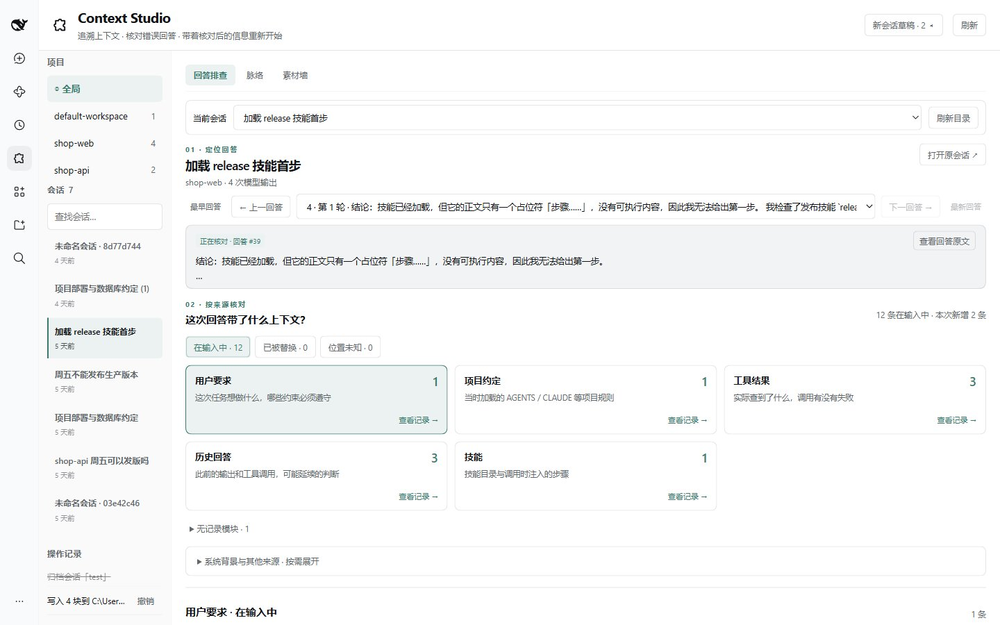

</div>

## 为什么要有拼图台

用 DeepSeek Harness 久了，每个项目都会攒下一堆「给 agent 看的东西」：`AGENTS.md` 里一条条约定、`.agents/skills` 里的技能、几十个历史会话。问题随之而来：

- **AI 分析错了，却不知道从哪里查。** 它收到的是哪版指令？引用会话有没有截断？是否把失败的工具结果当作依据？需要能回到具体回答之前逐条核对。
- **看不见，也不敢删。** 哪条约定还指向早已删掉的目录？哪条和全局指令重复？要逐行翻文件，删错了也找不回来。
- **复用靠复制粘贴。** B 项目想要 A 项目「部署」那一节，只能手动粘过去，来源也丢了。
- **开工前手工拼上下文。** 新会话要带哪些约定、参考哪次会话、看哪些文件，全凭记忆拼，也不知道占了多少 token。
- **分不清哪些东西是连在一起的。** 哪几个会话是接着同一件事聊下来的？哪份指令是所有会话都在用的底座，哪份只有某条线在用，哪份根本没被加载过？光看文件列表看不出来。

工作台把主流程改为：**选择会话和回答 → 追溯上下文 → 核对原文和问题线索 → 选择所需片段 → 检查草稿 → 开新会话**。脉络图帮助理解会话间的分支，素材墙继续负责记忆清理与跨项目写入。

## 核心理念

| | |
|---|---|
| 🔎 **以历史记录为依据** | 回答排查使用回答前的日志前缀，区分保留、已替换、位置未知；不把今天的文件冒充当时的输入。问题线索需要人工核实。 |
| ✂ **只带走所选内容** | 选择原文中的几句话，保留会话与事件来源；不因为摘录一段话就自动引用整场会话。 |
| 🌿 **从会话出发** | 先看会话之间的分叉、引用、子代理关系，再看每个会话实际加载了哪些记忆、是哪个版本。关系都来自 DSH 会话日志里的真实记录，不靠猜。 |
| 🧩 **素材即拼图块** | 指令文件按小节、列表项拆成一块块，每块都标出来源文件和行号、改动时间、token 估算。 |
| 🔍 **只标不删** | 脉络图标出本次读取范围内未发现使用的记忆；体检标出路径失效、和别处重复、很久没改、被同名文件遮蔽的块。删不删由你决定。 |
| ↶ **改动都能撤销** | 动文件前先整份备份；撤销时如果文件之后又被改过，就拒绝撤销，不覆盖你的新改动。 |
| ✋ **你按了才算数** | 移除、归档、写入、分叉都要在确认框里再点一次。开新会话只帮你填好草稿，发送要你自己按。 |
| 🔌 **只用 DSH 原生机制** | 写进去的约定由 DSH 自己的 `agent-instructions` 加载，会话引用用 DSH 原生的 `dsh-session:` 提及。插件不另建注入通道。 |

当前工作树为 **v1.3.0 本地改进版，尚未推送或发布**。解决长历史打不开，并把回答排查改成模块目录与按需原文分页；验证结果及剩余不足见 [本版工程校验](docs/REVIEW-1.3.md)。上方 release 徽章仍指向已公开版本。

## 快速开始

**要求**：DeepSeek Harness `0.2.x`（桌面版或网页版），Node.js ≥ 22。

```bash
# 1. 拿到插件
git clone https://github.com/h958661134/dsh-plugin-context-studio.git

# 2. 装进 DSH 的 web profile（参数会转给 pnpm）
dsh plugin --profile web add ./dsh-plugin-context-studio

# 3. 重启 DSH
```

桌面版将安装命令中的 `--profile web` 改为 `--profile desktop`。已用本地目录安装的用户，更新目录后**完全退出并重新打开桌面 DSH**即可加载修改；只关窗口可能仍驻留托盘，不需要重复安装或填写 key。

重启后，左侧栏会多出 **「拼图台」** 入口，首次打开新版默认进入「回答排查」；以后记住你选择的视图。

> 建议先用一个隔离的 `DSH_HOME` 起一个网页版试用：
> `DSH_HOME=/tmp/dsh-try dsh --profile web --no-open --port 4001`

**从旧版本升级**：在插件目录里拉取最新代码，然后重启 DSH。不需要重新安装，操作记录和备份都会保留。

```bash
cd dsh-plugin-context-studio
git pull
```

每个版本改了什么见 [CHANGELOG.md](CHANGELOG.md)。

## 界面一览

本节前两张为 v1.3 隔离 DSH 的真实界面；其余历史截图保留为功能参考。

界面围绕排查与重新开始组织：

- **左栏**：项目、可搜索的会话列表和操作记录；
- **中栏**：**回答排查 / 脉络 / 素材墙**。排查页先选回答，再选模块、核对历史原文及问题线索；
- **右栏**：**新会话草稿**（原拼盘）。默认收起，添加历史片段时展开；可跨会话选取、拖动排序、设置预算和任务。原文在可关闭的侧面详情中打开，窄屏适配窗口；草稿在窄屏放在下方。

### 回答排查：先选回答，再看输入模块（v1.3）

长历史先读结构目录，点到哪条才读取哪条的原文。超过旧版累计正文上限的会话，也能浏览回答、查看模块和分段选取内容。导航独立于脉络扫描；超时与重试会显示在对应位置。


1. **定位回答。** 在会话目录选会话，用前后按钮或下拉框找到有疑问的输出。一轮问题可能有多次输出，包含工具调用；长回答列表提供首末和分组导航。
2. **选择模块。** 用户要求、项目约定、引用会话、工具结果、历史回答、技能分别成卡片；系统与环境等背景按需展开。卡片显示输入、替换、未知的数量和线索；“在输入中”描述日志位置，不代表内容正确。
3. **核对原文。** 点击模块进入记录列表，再点「查看原文 / 挑选」。正文每页最多 12,000 字符，工具参数单独查看。保留事件编号、来源路径、引用边界和替代关系，详情失败可以单独重试。
4. **挑选再开始。** 选中几句话或添加本页原文，带着来源加入草稿。跨模块、跨会话继续挑选，再检查完整草稿并打开新会话。

“已被替换”和“位置未知”单独筛选，不混入当前输入。记录列表每页 16 条，搜索仅匹配标题和预览。分页不会标成历史被截断；附件、异常内容等真正没有展开的部分会明确提示。

**实测例子**：在「加载 release 技能首步」中选择最后一次回答，工具结果模块有 3 条。打开 `read` 结果，可见当时的 `SKILL.md` 正文确实只有「步骤……」。切到第一次输出时还没有后续工具结果，避免用后来发生的事解释早先的回答。

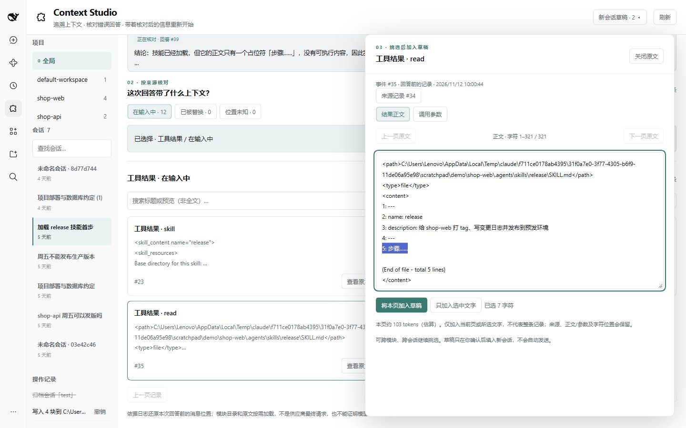

这能帮助核对证据，不能自动证明模型为什么判断错误。界面是**日志消息位置重建**，不是供应商最终请求包；附件投影与隐藏推理不还原，不展示虚假的全历史 token 总数。

### 挑几句话，带着来源重新开始

在原文框中选中需要的文字，点 **「只加入选中文字」**；或者点 **「将本页加入草稿」**。长消息可继续翻页到末尾，每次只添加本页或选中部分；来源保留正文 / 调用参数及绝对字符区间，不会把另一页误判为已经添加。字符位置使用 JavaScript UTF-16 偏移，分页不拆开完整的 Unicode 字符。

可以从不同会话选取内容，再在右栏选择目标项目、填写新任务、预览完整草稿。内容保留会话 ID、事件编号、来源名称；已替换的历史内容带提示。摘录是普通参考文本，目标项目自身的指令仍由 DSH 加载。

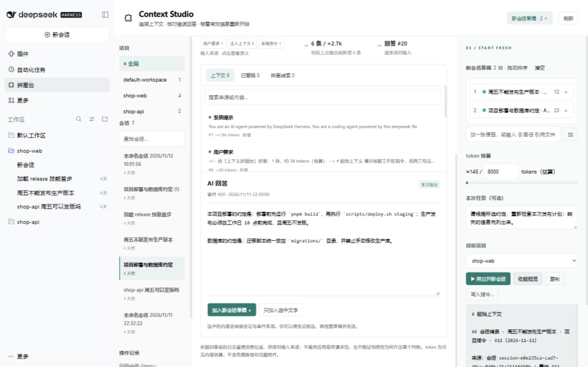

确认后只预填 DSH 的输入框，**由你检查后发送**。已有草稿默认追加，也可以明确选择替换。

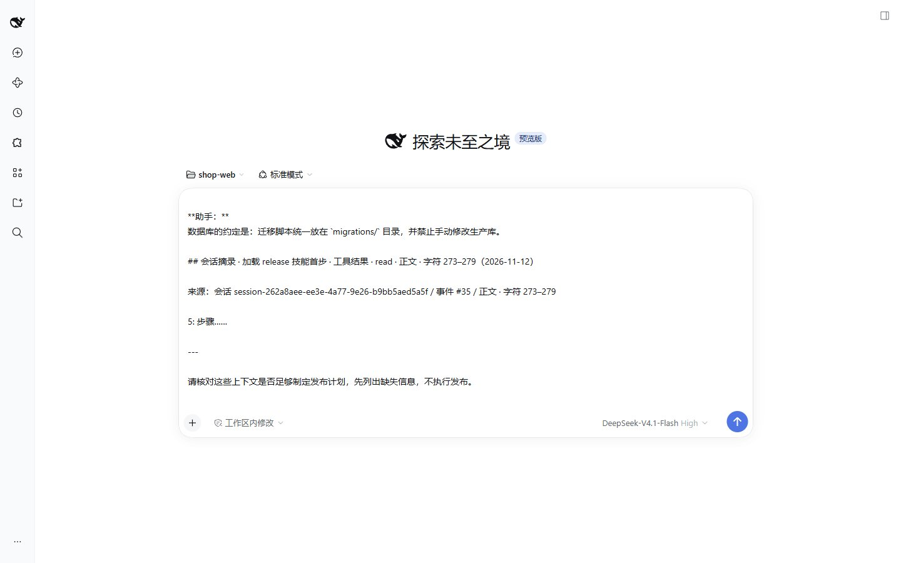

### 脉络：从会话出发，看哪些是一条链、哪些是独立的（v1.1）

切换到「脉络」视图。左边像 git 图：每个会话是一个点，**分叉**画实线，**引用会话**画虚线，**子代理**画点线。连在一起的是一条**链路**，没连线的归到**独立会话**。右边是**记忆矩阵**：每列是一份指令文件或一个技能，● 表示这个会话加载过当前版本，○ 表示加载的是旧版本（文件后来改过）。

这些关系都来自 DSH 会话日志里的真实记录，不是按文本猜的：加载了哪些指令文件、带什么 sha1；调用了哪些技能；引用了哪些会话；从哪个会话分叉。

每份记忆按「被谁用过」分成四类，列底部的色条标出类别：

| 类别 | 含义 | 你可以 |
|---|---|---|
| **共享** | 被不同的链路或独立会话用过，是公共底座 | 放着别动 |
| **链内** | 只在一条链路里用过 | 迁移这条链时一起带走 |
| **单次** | 只有一个会话用过 | 看看是不是一次性的东西 |
| **未用** | 读到的会话里一次都没加载过 | 很可能已经过时，去素材墙看内容、移除（可撤销） |

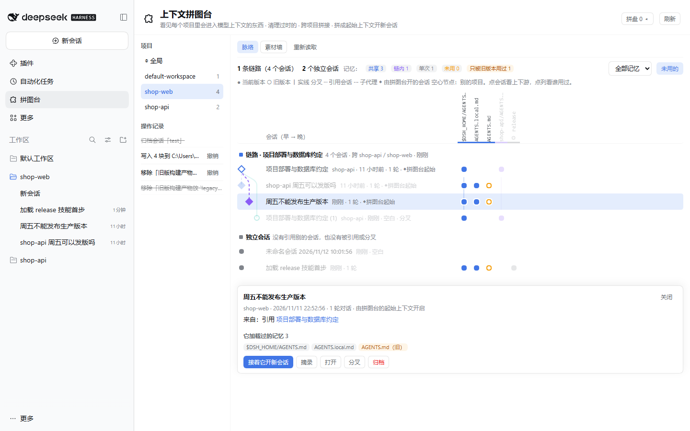

- **点一个会话**：高亮它的上下游和它加载过的记忆。可以接着它开新会话（作为 `@会话` 引用放进拼盘）、摘录、打开、**分叉**（先确认，在 DSH 里复制整段历史，不发送消息）、归档（可撤销）。
- **点一列**：高亮用过这份记忆的会话，并说明它属于哪一类、是不是只被旧版本用过、里面有没有从别的项目拼入的内容。
- **点链路标题**：高亮整条链用到的全部记忆，可以把最近 3 个会话一次放进拼盘。DSH 一条消息最多展开 3 个会话引用。

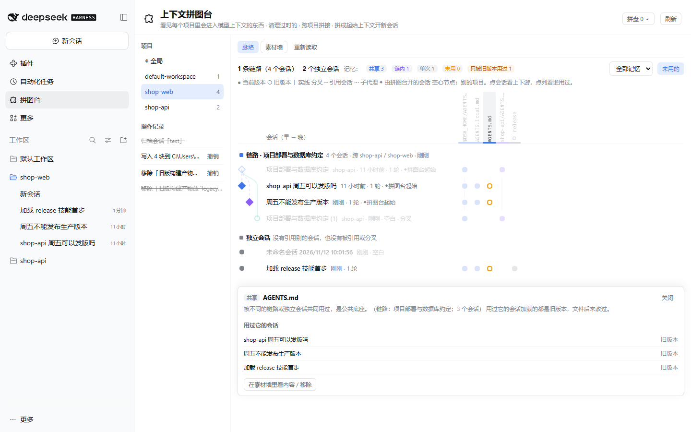

### 素材墙：看见每一块

点中栏顶部的 **素材墙** 标签，或者在脉络图里选中一列记忆后点 **在素材墙里看内容 / 移除**，就会切到这里。素材墙按文件和小节列出当前项目的所有素材，每块都标着来源、新旧、token 和体检结果。

| 类型 | 来自哪里 | 能做什么 |
|---|---|---|
| **指令** | 项目根到工作区每一级的 `AGENTS.md` / `CLAUDE.md` / `*.local.md`，子目录里的同名文件；全局的 `$DSH_HOME/AGENTS.md`、`~/.agents/AGENTS.md` | 看、移除、拼到别的项目、放进拼盘 |
| **技能** | `.dsh/skills`、`.agents/skills`，以及全局的技能目录 | 看、放进拼盘 |
| **会话** | 工作区里的会话（跳过子代理） | 看消息、挑摘录、归档、以 `@会话` 形式放进拼盘 |
| **Dot 记忆** | 装了 [Dot 总管](https://github.com/h958661134/dsh-plugin-dot) 时，在「全局」里只读显示 | 放进拼盘 |

点 **⚠ 可疑** 只看体检标出来的块：

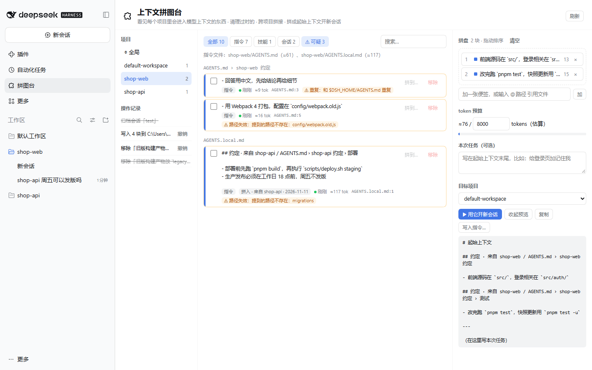

| 标记 | 含义 |
|---|---|
| 路径失效 | 块里用反引号写的路径（如 `` `config/webpack.old.js` ``）在项目里找不到 |
| 重复 | 同样的话在全局指令、同目录 `CLAUDE.md` 或其他层级里已经有了 |
| 陈旧 | 所在文件超过 90 天没改（可配置） |
| 被遮蔽 | `CLAUDE.md` 和同目录 `AGENTS.md` 内容一样，DSH 只会加载一份 |

从别的项目拼过来的块会带「拼入 · 来自 shop-api · 日期」标签。它在新项目里如果提到不存在的路径，同样会被标出来，提醒你核对。

### 移除：先确认，可撤销

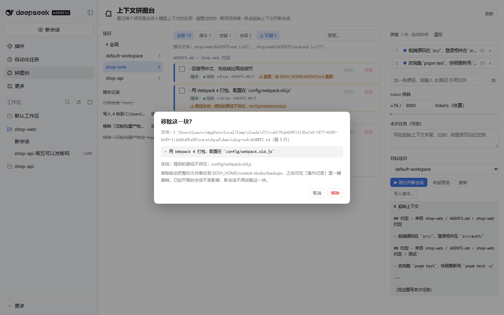

确认后，插件会把整份文件备份到 `$DSH_HOME/context-studio/backups/<操作 id>/`，再从文件里删掉这几行。左下角的「操作记录」里随时可以 **撤销**。

### 拼盘：跨项目挑块，拼成起始上下文

在素材墙里勾选素材，或者直接把它拖到右边的拼盘，再拖动调整顺序。在脉络图里，选中会话后点 **接着它开新会话**，或者选中链路后把最近 3 个会话一次放进来，也会进入拼盘。还可以：

- 输入 `@src/auth/login.ts` 引用文件，或者写一张便签；
- 在「本次任务」里写一句任务，它会放在起始上下文的末尾；
- 看 **token 预算条**：超出预算时，从超出的那一块开始标红。

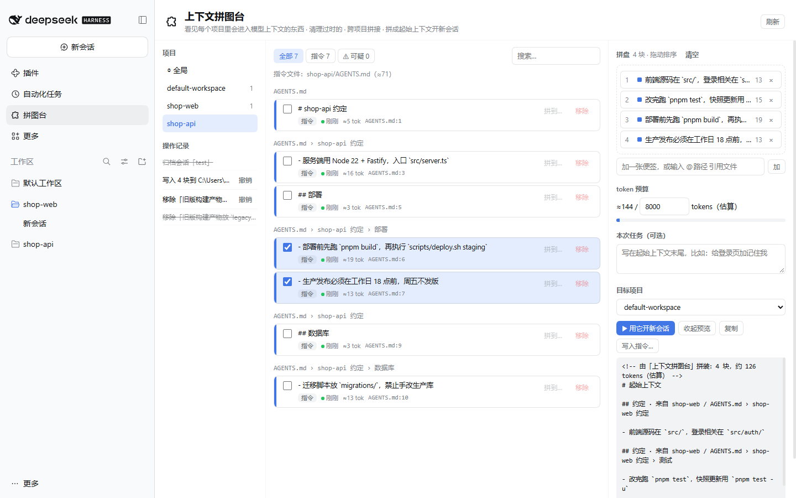

拼好以后有三个出口：

1. **▶ 用它开新会话**：在目标项目里打开空白会话，把拼好的内容填进输入框。**不会自动发送。** 如果那个会话里已经有没发出去的草稿，你可以选择接在后面，或者替换掉。

   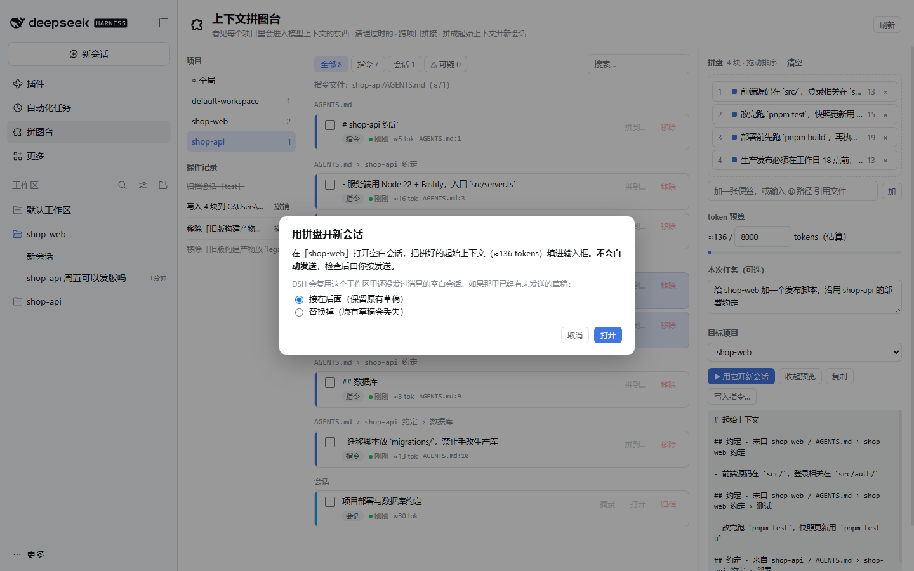
   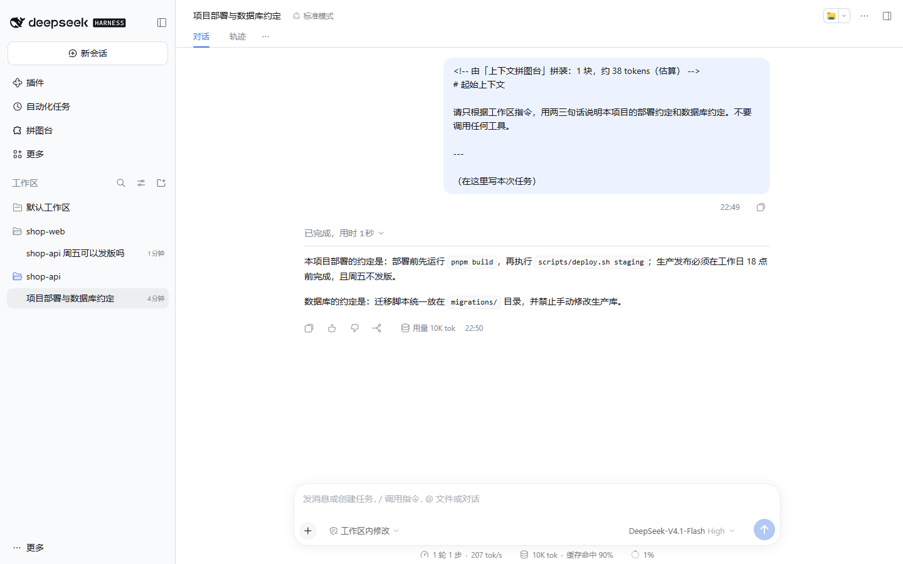

2. **写入指令…**：把拼盘追加到目标项目的 `AGENTS.local.md`（默认，通常不进版本库）或 `AGENTS.md`。之后该项目的新会话都会自动加载。

   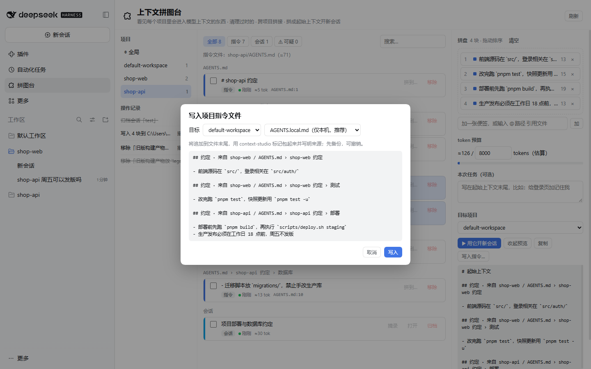

   写进去的内容会用标记包起来，注明来源：

   ```markdown
   <!-- context-studio:begin id=20261111144038-11c606 from="shop-api" at=2026-11-11 -->
   ## 约定 · 来自 shop-api / AGENTS.md › shop-api 约定 › 部署

   - 部署前先跑 `pnpm build`，再执行 `scripts/deploy.sh staging`
   - 生产发布必须在工作日 18 点前，周五不发版
   <!-- context-studio:end -->
   ```

3. **复制**：复制到剪贴板，你自己去用。

拼盘里的 `@会话` 是 DSH 原生的会话引用。发送后，DSH 会把它渲染成会话芯片，并把那个会话的有界快照一起交给模型。下面这个例子：在 shop-web 里问「shop-api 能在周五下午发生产版本吗」，模型根据引用的 shop-api 会话回答「不能，因为约定是周五不发版」。

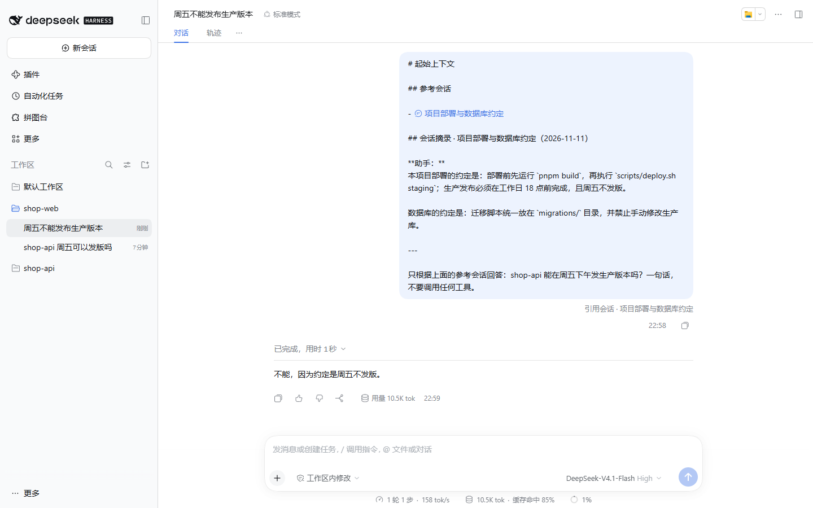

素材卡上的 **拼到…** 按钮可以把单块素材直接写进另一个项目，不用经过拼盘。

## 安全模型

| 会做 | 不会做 |
|---|---|
| 只读 DSH 已知会加载的位置：指令候选文件、技能根目录、会话、Dot 的状态文件。脉络图通过 `sessionQuery.readSession` 读会话日志，取加载记录、技能调用、会话引用和分叉信息；回答排查读取选定回答前的消息 | 文件操作不采用客户端传来的任意路径，服务端按「项目 + 素材 id」重新定位；脉络还会只读核对历史加载记录中的文件路径 |
| 回答排查只读取会话日志中的可见文本与白名单元数据 | 不替换历史输入、不读取 API key、不返回原始模型流、隐藏推理或完整请求头 |
| 所选片段与任务保存在本机浏览器；保存失败持续提示，损坏草稿保留原值供导出；预填前检查来源和预算 | 不自动发送到模型；清空草稿不改源会话 |
| 你在确认框里点了「移除 / 归档 / 写入」才动手 | 不自动删，不批量静默改 |
| 改文件前整份备份并持久化准备记录；中断后核对状态，不自动重放；正常已提交记录可撤销 | 不物理删除任何文件。撤销「新建文件」时，是把文件挪进备份目录 |
| 移除前核对文件哈希必须和你看到的一致 | 不在过期视图上改文件，会提示你先刷新 |
| 撤销前核对文件没被别人改过 | 检测到冲突就停止并给出备份；最终检查与替换之间无法对外部编辑器提供严格 CAS 保证 |
| 会话只**归档**（DSH 原生，可取消归档）；会话正在运行时 DSH 会拒绝归档 | 不删除会话日志，也不会替你停掉正在运行的会话 |
| **分叉**先弹确认框，用 DSH 原生的 `forkSession` 新建会话，复制到目前为止的历史 | 不发送任何消息；不想要了可以归档 |
| 写入只追加到目标项目的 `AGENTS.local.md` / `AGENTS.md`（全局只写 `$DSH_HOME/AGENTS.md`） | 不改系统提示、preset，也不改 Dot 的记忆 |
| 开新会话只预填草稿 | 不替你发送，不调用模型，也不碰 API key |
| 接口只接受本机同源请求；写操作还要带 `X-Context-Studio: 1` 头和 JSON 请求体 | 不对外暴露任何接口 |

已有文件先写临时文件、同步后替换，新文件采用不覆盖发布；保留原来的换行风格（CRLF/LF）。操作准备记录、备份和协作锁用于异常恢复，不宣称断电事务保证。日志保留最近 200 条完成记录，待恢复和冲突项额外保留；备份尚未自动清理。

## 配置

默认什么都不用配。要调整的话，在你自己 profile 的 `cordis.patch.yml` 里按 id `context-studio` 覆盖：

```yaml
- replace:
    - id: context-studio
      name: dsh-plugin-context-studio
      config:
        staleDays: 60
```

| 字段 | 默认值 | 说明 |
|---|---|---|
| `staleDays` | `90` | 文件或会话超过多少天没动，就标记为「陈旧」 |
| `sessionLimit` | `50` | 素材墙和脉络扫描每个项目最近的顶层会话数。回答排查使用独立目录，最多列出所选范围最近 300 个会话；超过时会提示缩小项目范围 |
| `dataDir` | `$DSH_HOME/context-studio` | 操作日志和备份放在哪（绝对路径） |
| `trustedHosts` | `[]` | 额外允许的 Host 名；仍要求连接来自回环地址、完整同源。它不是远程访问授权或鉴权替代 |

## 常见问题

**一直显示“读取脉络中”怎么办？**
先确认完全重启 DSH，加载本地 v1.3.0。会话目录已不依赖全量脉络；可以切到“回答排查”选一个会话。读取请求客户端最多等待 25 秒，宿主 GET 最多等待 20 秒；超时后可重试。宿主不支持中止完整日志读取，插件会合并相同未结束请求并限制并发；后台永久挂起时可能提示繁忙，需要重启宿主恢复。原生桌面窗口尚待用户重启验收，隔离版完成了切换、挂起与恢复测试。

**内容太长或出现坏记录怎么办？**
新版按模块和原文页读取，回答导航每组最多 80 项，能继续翻组。坏记录会在对应位置提示；无法确认事件顺序时拒绝推测历史。草稿单项或任务超过 20,000 字符会拒绝，总请求体上限 512 KiB；不要把分段浏览等同于可以无限扩大单个草稿。

**提示操作记录待恢复或操作锁被占用怎么办？**
先刷新操作记录核对，不要重复点击写入。若进程曾崩溃，须先确认旧进程已退出且没有写入，再人工处理提示中的遗留锁；之后刷新记录核对准备状态。不要删除备份或直接覆盖冲突文件。当前没有一键恢复向导。

**能直接告诉我 AI 为什么错了吗？**
不能证明内部因果。先对照原问题看约束是否出现，再检查指令版本、被替换的原文、引用省略和工具结果；线索只是需要核对的事实。没有告警也不表示回答正确。

**长会话还会遇到容量限制吗？**
新版不再因累计正文超过 100 万字符或 2,000 条输入而阻断整页。结构目录最多处理所选回答前 250,000 条事件；超过这个保护范围会保留回答导航和回答原文入口，让你在插件里选更早的回答，不会把数量显示为 0。单条消息超过 100,000 个内容块、异常结构化工具参数或附件会明确提示未展开。

DSH 的 `readSession` 仍须先读取完整日志，首次打开超大压缩日志可能慢或超时；插件不能把宿主读取改造成真正的流式磁盘读取。最多缓存两份快照、10 秒后释放，手动刷新重新读取。原文页上的 token 只估算本页。

**为什么「上下文」和「素材墙」里的内容不一样？**
排查页显示历史日志当时记录的文本；素材墙显示磁盘上现在的文件。文件后来改了，两边本来就可能不同。位置未知的记录会单独列出；不支持的图片投影会提示限制。

**摘录一段会话会把整段历史也带过去吗？**
不会。「只加入选中文字」和「将本页加入草稿」只带走本页或选中的文本与来源。只有主动添加 `@会话` 引用时，DSH 才会展开有界快照。新项目自己的全局 / 项目指令依然会加载。

**脉络图里的关系是怎么来的？准吗？**
都来自 DSH 会话日志里的真实记录，不是按文字猜的：

- 加载了哪些指令文件：`agent-instructions` 的加载记录，带文件内容的 sha1；
- 用过哪些技能：用户直接调用，或者模型调用 `skill` 工具；
- 引用了哪些会话：`session-reference` 的记录；
- 子代理：会话头里的 `parentSession`。

普通分叉在 DSH 里不记录来源。插件通过分叉会话继承来的那些消息找回来源。在 v1.1 之前分叉、来源会话又已经找不到的，可能显示为“未检出关联”；不能据此确认它独立。

**某份记忆显示「未用」，就能删吗？**
不一定。「未用」只表示读到的会话（每个工作区最近 50 个）里没有一个加载过它。常见原因有三种：它已经过时；它被同目录内容相同的文件遮蔽了，比如 `CLAUDE.md` 和 `AGENTS.md` 一样，DSH 只加载一份；它在子目录里，而会话还没碰过那个目录。到素材墙里看过内容再决定，移除了也可以撤销。

**「旧版本」是什么意思？**
会话加载那份文件时记下了它的 sha1，和文件现在的内容对不上，说明文件后来改过或删掉了。这个会话当时看到的是旧内容；当前文件读取失败时标记未知，不等同于文件已删除。

**为什么 Dot 记忆不在矩阵里？**
Dot 记忆由 Dot 插件自己注入，会话日志里没有统一的标识，看不出哪个会话用了哪条。在素材墙的「全局」里仍然能看到并放进拼盘。

**为什么矩阵是按整个文件算，而不是按块？**
日志里只记录了整个文件的 sha1。某一块的内容要在素材墙里看。

**「分叉」和「接着它开新会话」有什么区别？**
分叉会复制到目前为止的全部历史，适合换个方向接着聊。接着它开新会话是把它作为 `@会话` 引用放进拼盘，由 DSH 展开成有界快照，再加上你挑的约定和任务，适合只带走结论。

**为什么没有「memory」类型？**
DSH 本身没有叫 memory 的存储。真正会进入模型上下文、相当于「记忆」的东西是：指令文件、技能、会话，以及第三方插件（比如 Dot）自己的记忆。拼图台把这些都列出来了。

**移除以后，正在进行的会话还会看到那条约定吗？**
会。DSH 在会话第一次请求时加载指令，之后只在 agent 读写到相关目录时增量刷新。新开的会话就不会再加载了。

**为什么默认写 `AGENTS.local.md`？**
`*.local.md` 是 DSH 支持的本地叠加文件，通常不提交到版本库。默认写这里，从别的项目拼来的约定不会悄悄进入团队仓库。想共享的话，在对话框里改选 `AGENTS.md`。

**撤销失败，提示文件被改过，怎么办？**
这是为了保护你之后的改动。提示里会写出备份文件的路径，你可以自己对比后手动恢复。

**token 数准吗？**
是估算值，按 DeepSeek 官方的经验值算：中文约 0.6 token/字，英文约 0.3 token/字符。用于粗略比较。引用会话、文件展开以及目标项目自动注入的内容不包含在草稿估算中，不能据此保证请求不超窗。

**会话为什么不能直接拼「全文」？**
拼盘里的 `@会话` 用的是 DSH 原生的会话引用，发送后由 `dsh-session-reference` 展开成有界快照，不会一下子塞满上下文。要精确挑内容，用「回答排查」选择原文；旧的会话卡「摘录」入口也仍可用。摘录只列出你亲手发的消息和助手的回答，运行时注入的指令、时间、环境快照不会出现在里面。

## 工作原理

```
浏览器（lib/client.js，手写的 DSH client 模块，免构建）
  左栏入口「拼图台」+ 主区整页（slots: sidebar.panellist / main）
  │  fetch /api/dsh-plugin-context-studio/*（同源 + X-Context-Studio 头）
  │  ctx.uiWorkspace.startSession(workspaceId, { prompt, whenDraftExists })  ← 开新会话
  │  ctx.uiWorkspace.openSession(sessionId) / forkSession(sessionId)         ← 打开 / 分叉
  ▼
Host（lib/host.js，全局 Cordis 插件，inject: webServer）
  ├─ scan.js      项目 → 素材（指令 / 技能 / 会话 / Dot）+ 体检
  │                 用到 ctx.workspaceRegistry、ctx.sessionQuery（可选，缺了就降级）
  ├─ graph.js     会话日志（sessionQuery.readSession）→ 会话链 / 独立会话 × 记忆使用矩阵
  │                 GET /api/dsh-plugin-context-studio/graph?project=（只读）
  ├─ reads.js     独立会话目录 /sessions?project=；共享读取、并发保留与截止时间
  ├─ context-view.js  历史位置索引 → 模块目录 / 记录页 / 按需原文页
  │                 GET /inspect-view?id=&answer=&module=&state=&page=
  │                 GET /inspect-detail?id=&answer=&event=&offset=&part=
  ├─ inspect.js   旧 inspect 接口兼容；新版 UI 不再调用其整段快照
  ├─ markdown.js  指令文件拆块、按行删除、带标记追加
  ├─ ops.js       移除 / 写入 / 归档 / 撤销；备份、日志、哈希校验、原子写
  ├─ compose.js   拼盘渲染 + 预算
  ├─ tokens.js    token 估算
  └─ guard.js     本机同源校验
数据：$DSH_HOME/context-studio/{journal.json, backups/}
```

用到的每个 DSH 接口都在源码里核对过，出处见 [docs/DESIGN.md](docs/DESIGN.md#3-素材盘点以源码为准)；脉络图用到的日志字段见第 10 节，历史上下文检查的边界见第 11 节，本版模块与分页实现见第 13 节。

## 路线图

- [x] v1.0：素材墙、体检、移除 / 归档 / 撤销、拼盘、跨项目写入、预填草稿开新会话
- [x] v1.1：脉络图：从会话出发看链路和独立会话、记忆四分类、版本对比、分叉
- [x] v1.2：回答排查、历史上下文和工具结果、局部摘录开新会话、界面整理
- [x] v1.2.1：加载截止与重试、独立导航、坏记录防御、写前日志和故障恢复测试
- [x] v1.3：输入模块、回答导航、记录与原文分页、按页摘录复用
- [ ] 键盘完整操作、确认框焦点管理、草稿清空撤销、宿主流式超大历史读取
- [ ] 原生桌面各版本及高 DPI 矩阵验收、备份清理和恢复向导
- [ ] 相邻两次请求的文本差异视图、指令冲突人工标注
- [ ] 供应商消息投影与附件 token 的更完整对照
- [ ] 配方：把拼盘存成命名配方，按项目和任务类型一键复用
- [ ] 技能移植：把技能目录复制到目标项目的 `.agents/skills`（不覆盖同名技能）
- [ ] 语义体检：请模型判断某条约定和代码是否还一致（先征得你同意再花 token）
- [ ] 会话精华提炼：选一段会话，让模型提炼成一条约定草稿，你确认后再写入
- [ ] 两个项目各有一版同名小节时，做差异合并
- [ ] 接入 DeepSeek tokenizer，给出精确 token 数

完整设计见 [docs/DESIGN.md](docs/DESIGN.md)。

## 参与开发

用起来哪里不顺手、想要什么功能，欢迎到 [Issues](https://github.com/h958661134/dsh-plugin-context-studio/issues) 里提。

```bash
npm test          # node:test，203 个用例，不依赖 DSH
```

- 纯 JavaScript ESM，加 `// @ts-check`。运行时不依赖任何 `@deepseek-ai/*` 包。
- 改完插件代码要重启 DSH 才会生效。
- 请在隔离的 `DSH_HOME` 下试，不要动你日常用的 profile。
- 发版前按 [docs/RELEASING.md](docs/RELEASING.md) 的清单逐项检查。README 要整篇对照新功能更新，不能只加一节。

## License

[MIT](LICENSE)
