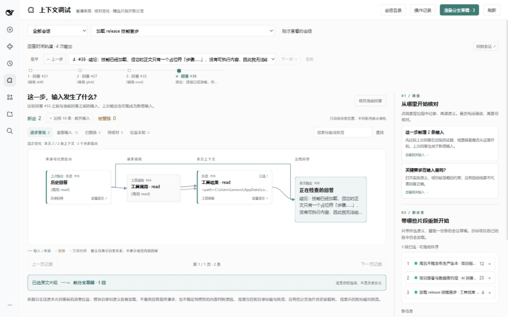

<div align="center">

# Context Studio · 上下文调试

**定位一条回答，沿着上下文往回查。看清这一步变了什么，带着核对后的证据重新开始。**

[](https://github.com/h958661134/dsh-plugin-context-studio/releases)
[](docs/REVIEW-1.4.md)
[](https://github.com/deepseek-ai/deepseek-harness)
[](https://nodejs.org)
[](LICENSE)



</div>

当前本地版本为 **v1.4.0，尚未推送或发布**。Release 徽章指向已公开版本。新版围绕“排查回答 → 核对证据 → 整理新分支”设计，旧脉络图和素材墙不再作为页面入口；原有文件、备份、草稿和操作日志不会因此删除。

## 它能帮你找到什么

AI 的回答不符合预期时，光看到“项目约定 3 条、工具结果 5 条”没有用。你需要知道：

- 错误从哪次输出开始？与上一步相比，新增了什么？
- 关键要求是否还在输入里，还是被后续消息替换了？
- 工具实际返回了什么，引用会话有没有省略，是否沿用了早先的错误结论？
- 哪几段证据值得保留，哪些应该先排除，再换一个会话继续？

Context Studio 把**回答、输入记录与来源关系**放到同一张图上。点线索定位节点，点节点读历史原文，再将所需片段放进新分支草稿。图依据 DSH 日志，不用今天的文件替代过去的输入，也不需要调用模型分析。

它能帮助核对事实，不能证明模型内部为什么作出判断。没有警告不代表回答正确。

## 快速开始

要求：DeepSeek Harness `0.2.x`，Node.js ≥ 22。

```bash
git clone https://github.com/h958661134/dsh-plugin-context-studio.git
dsh plugin --profile desktop add ./dsh-plugin-context-studio
```

网页版使用 `--profile web`。安装或更新后，**完全退出 DSH（包括托盘）再打开**。已链接本地目录的用户无需重复安装；本地修改不会自动成为 GitHub 发布版。

不需要给插件填写 API key。建议用独立环境试用：

```bash
DSH_HOME=/tmp/context-studio-try dsh --profile web --no-open --port 4001
```

每个版本的变化见 [CHANGELOG](CHANGELOG.md)。

## 怎样排查一条错误回答

### 定位回答，找到开始偏离的那一步

先在 DSH 打开要检查的会话，再进入“上下文调试”，即可跟随刚才查看的会话；也可手动从目录选择。沿回答轨道往前看，一轮问题可能包含多次输出和工具调用，每一步都能检查；长轨道提供分组导航。

选中回答后，默认看**这步变化**。比较起点是上一次回答之前的输入，因此上次回答本身也是本步新增输入。

### 看输入怎么走，沿用、新增、替换分开

| 图上的内容 | 含义 | 怎样核对 |
| --- | --- | --- |
| 新增输入 | 上次回答前不在输入、这次位于输入中的记录 | 新证据是否错误、无关，或新增了约束？ |
| 沿用内容 | 两次回答前都在输入中的记录 | 旧要求和旧结论是否仍适用？ |
| 被替换内容 | 原先在输入中，后来被其他记录替换 | 重要约束在替代内容中保留了吗？ |
| 回答 → 请求调用 | 工具块 ID 精确匹配，排除批次冲突与歧义 | 模型请求了什么工具，参数是否正确？ |
| 调用 → 返回 | 通过日志调用 ID 配对 | 参数、实际结果与回答中的说法一致吗？ |
| 引用快照 → 注入记录 | 来自其他会话的历史快照 | 当时带进来的内容是否足够，有没有省略？ |
| 位置未知 | 日志无法确认其消息位置 | 单独核对，不能当成确定参与了回答 |

连线表达日志关系，**不表达模型一定依赖了哪句话**。图按页展示，页外来源用锚点表示；省略关联会提示。“全部输入”可逐页查看其他上下文，来源类型只是辅助标签。

### 点线索、读原文，判断问题是否成立

排查区列出有记录依据的线索：工具报错、引用截断、项目约定变更、回答中断。点击可定位相关节点。正文与调用参数分别分页，也能回看被替换的记录及来源事件。搜索只匹配标题和预览，不是全文搜索。

**真实例子**：「加载 release 技能首步」的最终回答说，技能只有占位内容。切到这一步，图会显示前一次 `read` 调用、实际返回和当前回答之间的关系。打开结果，`SKILL.md` 的历史正文确实只有“步骤……”。往前切到第一次输出，这些后续工具结果还没有进入输入。这样才能判断是模型忽略了已知步骤，还是证据本身就缺少步骤。


### 用核对后的片段建立新分支

在原文中选中文字，或加入当前页，放进**新分支草稿**。可跨会话挑选，再调整顺序、在新任务中加入修正说明、选择目标项目。顶栏“准备分支草稿”可直接进入确认。

草稿保留会话、事件编号、正文/参数和字符区间。同文位于不同位置时可以分别加入，不会把另一页误判为已选。

确认后调用 DSH 的 `startSession`，预填空白会话。已有草稿默认追加，也可明确选择替换，**发送由你完成**。这里的分支是用精选上下文重新开始，不是复制整段历史到某个过去时间点。目标项目自身指令仍由 DSH 加载。


## 安全边界

| 行为 | 边界 |
| --- | --- |
| 检查历史 | 只读选定回答前的日志；未来内容不进入该回答的输入图 |
| 读取原文 | 只返回可见文字与必要来源，不返回原始流、请求头、隐藏推理或附件载荷 |
| 判断错误 | 提供核对线索，不把相关性说成内部因果，不自动修改记忆 |
| 创建分支 | 所选内容存在本机浏览器；确认后只预填，不调用模型、不自动发送 |
| 升级旧版 | 不删除旧草稿、日志和备份；历史撤销保留，冲突时拒绝覆盖 |
| 访问接口 | 本机回环与同源检查；写接口有专用头和请求体校验 |

可见正文和参数本身可能包含敏感信息；展示白名单不是通用脱敏器。复制或带入新会话前，应核对实际选中的内容。

## 常见问题

**能从图上直接知道模型为什么错了吗？**

不能直接读取内部因果。可以定位关键约束是否存在、引用是否省略、工具是否失败、旧内容是否被替换，再人工判断是否解释了问题。模型已收到正确材料却判断错误，也是可能的。

**为什么出现其他会话的内容？**

引用会话会带入历史快照，图把引用来源与注入记录连接。引用不是对方会话的最新全文，可能有省略；检查的是这次实际注入的原文。

**为什么没有全请求 token 总数？**

原文页与草稿是可见文字估算，未包含目标项目自动注入、附件投影或工具 schema。图不是供应商最终请求包，不能提供精确的全请求总数。

**长历史还会卡住吗？**

图每页最多 12 条记录，原文每页最多 12,000 个 UTF-16 字符单位，长文本可继续分页，保留准确来源位置。完整 Unicode 码点不会被拆开。

DSH 的 `readSession` 仍先读取完整日志，首次打开超大日志可能慢或超时。所选回答前超过 250,000 条事件时保留回答导航，变化计数标记不可用。附件、异常参数与过多来源有明确限制，见[设计文档](docs/DESIGN.md)。

**持续加载或详情失败怎么办？**

先完全重启 DSH。会话导航独立加载，不等待文件或脉络扫描；图和详情可分别重试。请求有截止，但插件不能取消宿主底层永久挂起的 I/O，可能需重启宿主恢复。

**以前的素材墙和脉络呢？**

v1.4 移除了两个页面入口，专注回答排查。旧备份、文件和操作记录保留，撤销仍检查冲突。旧接口仅为兼容保留，不作为新界面的依赖；历史设计和验收记录仍在[设计文档](docs/DESIGN.md)。

**新分支会自动避开错误上下文吗？**

不会自动保证。需要你排除不需要的片段、补充修正说明；目标项目自己的指令依然加载。若问题来自这些指令，需要另行核对。草稿只是整理后的起点。

## 架构

```text
client.js：会话/回答轨道 → 流转图 → 原文详情 → 新分支草稿
  │ 同源 HTTP；uiWorkspace.startSession 只预填
  ▼
host.js
  ├─ reads.js          会话导航、读取去重与截止
  ├─ context-view.js   历史位置索引、有限缓存、原文分页
  ├─ context-flow.js   回答间变化、真实图关系、排查线索
  ├─ compose.js        草稿组合与预算
  ├─ ops.js            历史操作记录、备份及撤销
  └─ guard.js          回环、同源与请求校验
```

新接口为 `/api/dsh-plugin-context-studio/inspect-flow`，原文使用 `inspect-detail`。旧检查、扫描和写入接口保留兼容。纯 JavaScript ESM，无运行时 `@deepseek-ai/*` 依赖；客户端使用宿主共享 React，无需构建。

最多缓存两份快照、10 秒到期；浏览器仅持久化所选草稿与偏好。历史数据仍在 `$DSH_HOME/context-studio/{journal.json,backups/}`。旧配置 `staleDays` / `sessionLimit` 仅影响兼容扫描，`dataDir` 指定操作数据位置；`trustedHosts` 不能绕过回环与同源限制。

## 路线图

- [x] 原文分页、局部选取、历史来源与字符位置
- [x] 回答间输入变化、真实来源连线、线索定位
- [x] 所选上下文组成新分支草稿，只预填不发送
- [ ] 相邻内容逐字差异、人工问题标注
- [ ] 新分支生成后的原生会话关联回看
- [ ] 宿主支持下的流式日志、固定版本分页
- [ ] 原生桌面、高 DPI、键盘和屏幕阅读器完整矩阵
- [ ] 用户确认后调用模型生成排查假设

## 开发与验证

```bash
npm test
npm pack --dry-run
```

本地 v1.4 验证：**236/236 测试通过，0 跳过、0 TODO**；隔离4001实测完成当前会话跟随、回答切换、线索定位、原文选取与未发送草稿。桌面原生窗口仍需实际使用验证。

测试使用 `node:test`、合成日志、客户端 VM 与本地 HTTP；真实 UI 仅在独立 `DSH_HOME` 的 4001 端口验收。具体结果及不足见 [v1.4 工程校验](docs/REVIEW-1.4.md)。隔离浏览器通过不等于所有原生桌面版本已验收。

交互与视觉方案见 [设计说明](docs/DESIGN-ui-1.4.md)，数据来源见 [完整设计](docs/DESIGN.md)。发版按 [清单](docs/RELEASING.md) 更新 README、截图和测试记录，发布由用户决定。

欢迎通过 [Issues](https://github.com/h958661134/dsh-plugin-context-studio/issues) 反馈。

[MIT License](LICENSE)
