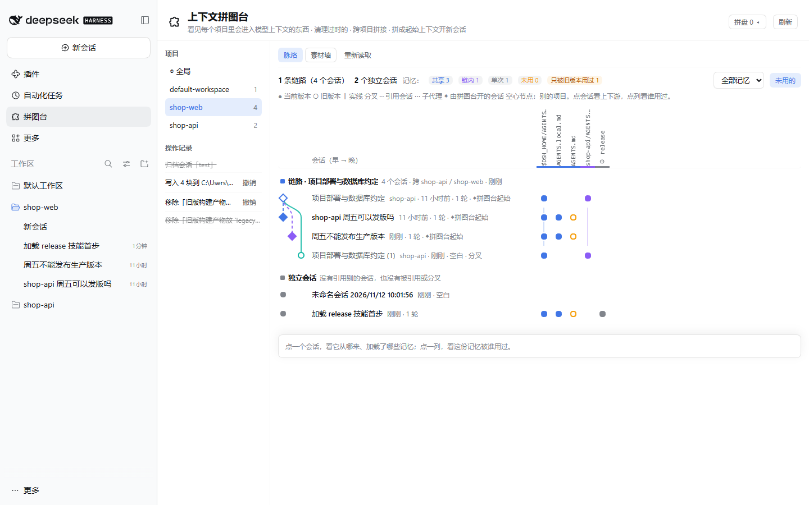
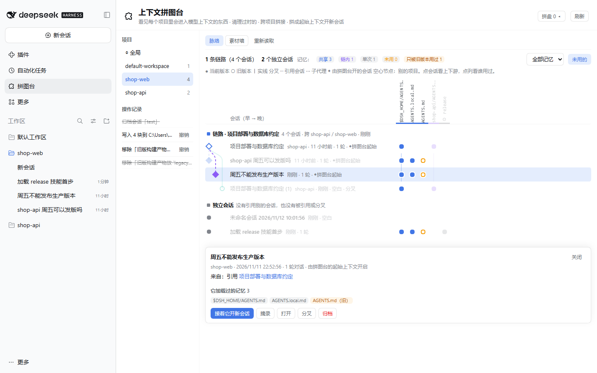
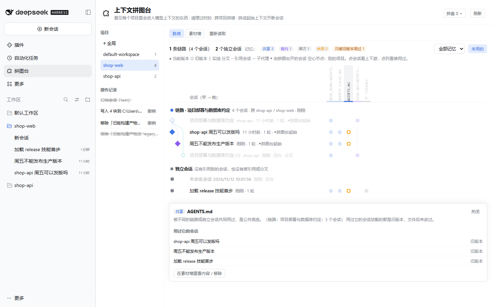
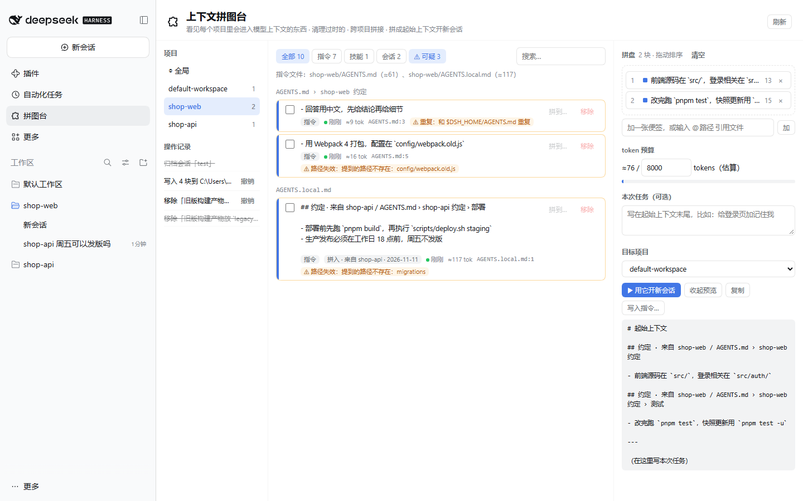
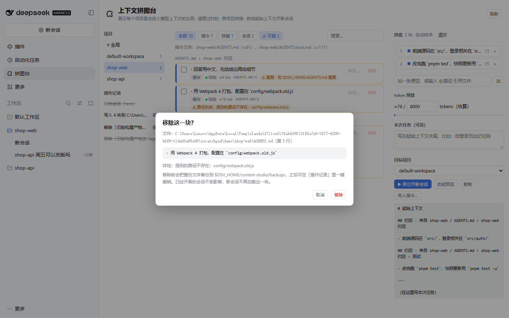
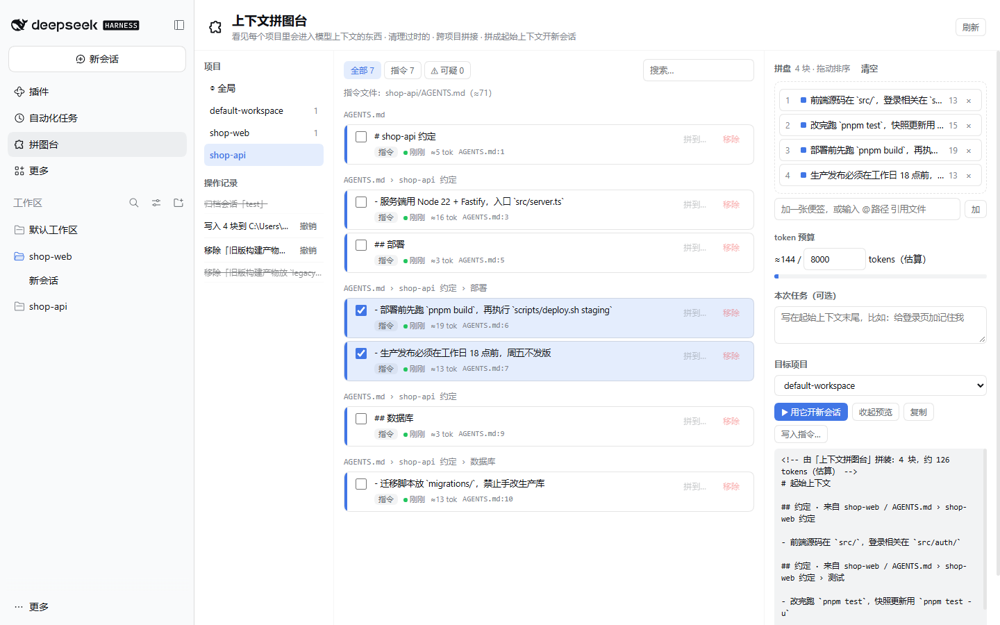
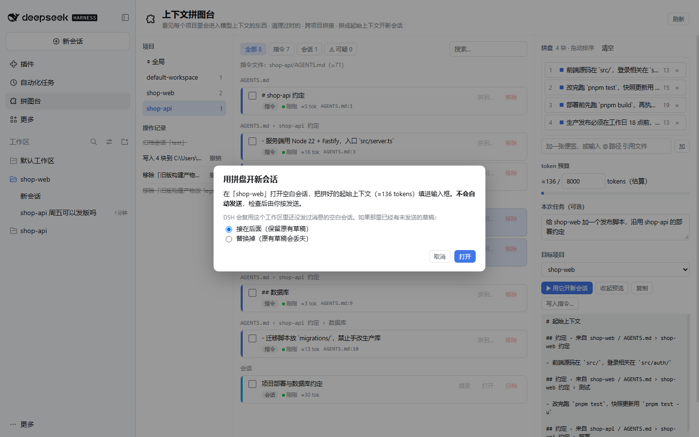
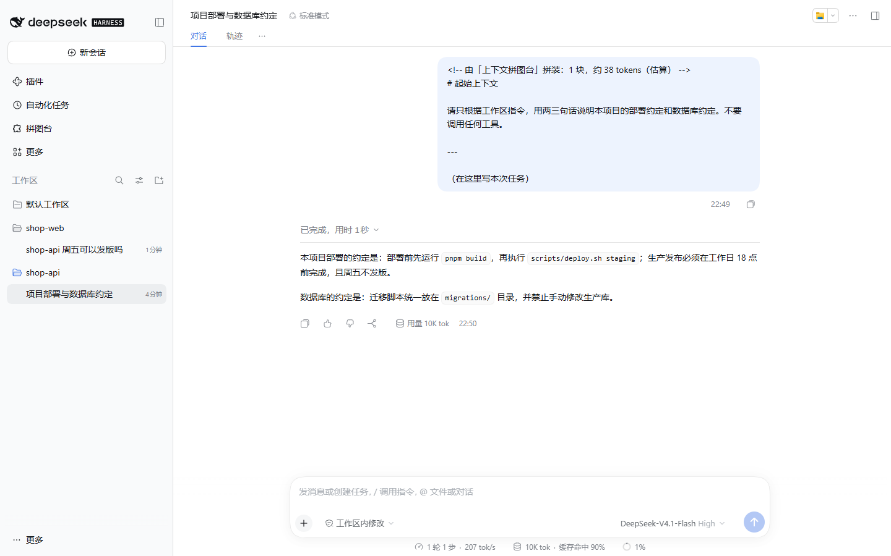
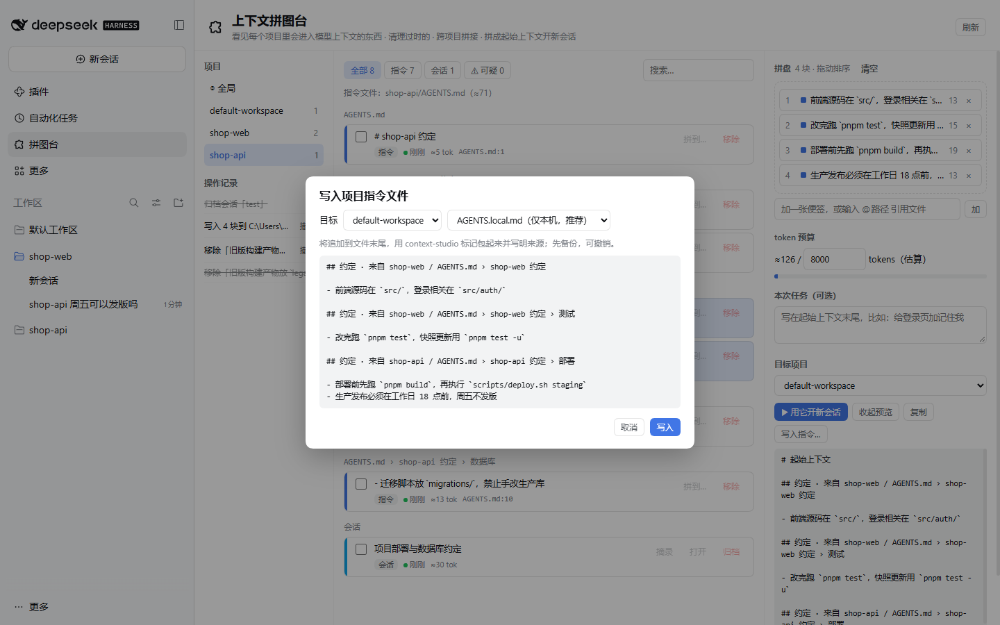
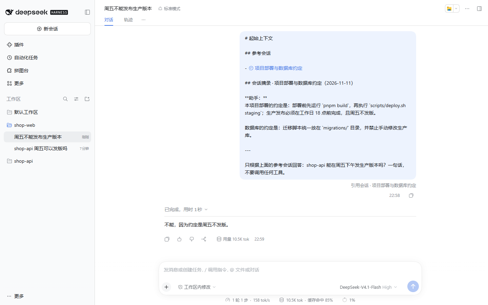

<div align="center">

# 上下文拼图台 · Context Studio

**从会话出发，看清每个会话用了哪些记忆：哪些会话连成一条链、哪些是独立的，哪些记忆是公共底座、哪些早就没人用了。清掉过时的，把有用的拼到别的项目，再拼成起始上下文去开新会话。**

[](https://github.com/h958661134/dsh-plugin-context-studio/releases)
[](https://github.com/deepseek-ai/deepseek-harness)
[](https://nodejs.org)
[](tests)
[](LICENSE)



</div>

## 为什么要有拼图台

用 DeepSeek Harness 久了，每个项目都会攒下一堆「给 agent 看的东西」：`AGENTS.md` 里一条条约定、`.agents/skills` 里的技能、几十个历史会话。问题随之而来：

- **看不见，也不敢删。** 哪条约定还指向早已删掉的目录？哪条和全局指令重复？要逐行翻文件，删错了也找不回来。
- **复用靠复制粘贴。** B 项目想要 A 项目「部署」那一节，只能手动粘过去，来源也丢了。
- **开工前手工拼上下文。** 新会话要带哪些约定、参考哪次会话、看哪些文件，全凭记忆拼，也不知道占了多少 token。
- **分不清哪些东西是连在一起的。** 哪几个会话是接着同一件事聊下来的？哪份指令是所有会话都在用的底座，哪份只有某条线在用，哪份根本没被加载过？光看文件列表看不出来。

拼图台把这些都摊成一张画板：**从会话出发看脉络 → 体检 → 移除（可撤销）→ 跨项目拼接 → 拼成起始上下文 → 开新会话**。

## 核心理念

| | |
|---|---|
| 🌿 **从会话出发** | 先看会话之间的分叉、引用、子代理关系，再看每个会话实际加载了哪些记忆、是哪个版本。关系都来自 DSH 会话日志里的真实记录，不靠猜。 |
| 🧩 **素材即拼图块** | 指令文件按小节、列表项拆成一块块，每块都标出来源文件和行号、改动时间、token 估算。 |
| 🔍 **只标不删** | 脉络图标出没有任何会话加载过的记忆；体检标出路径失效、和别处重复、很久没改、被同名文件遮蔽的块。删不删由你决定。 |
| ↶ **改动都能撤销** | 动文件前先整份备份；撤销时如果文件之后又被改过，就拒绝撤销，不覆盖你的新改动。 |
| ✋ **你按了才算数** | 移除、归档、写入、分叉都要在确认框里再点一次。开新会话只帮你填好草稿，发送要你自己按。 |
| 🔌 **只用 DSH 原生机制** | 写进去的约定由 DSH 自己的 `agent-instructions` 加载，会话引用用 DSH 原生的 `dsh-session:` 提及。插件不另建注入通道。 |

## 快速开始

**要求**：DeepSeek Harness `0.2.x`（桌面版或网页版），Node.js ≥ 22。

```bash
# 1. 拿到插件
git clone https://github.com/h958661134/dsh-plugin-context-studio.git

# 2. 装进 DSH 的 web profile（参数会转给 pnpm）
dsh plugin --profile web add ./dsh-plugin-context-studio

# 3. 重启 DSH
```

重启后，左侧栏会多出 **「拼图台」** 入口，点开默认就是脉络视图。

> 建议先用一个隔离的 `DSH_HOME` 起一个网页版试用：
> `DSH_HOME=/tmp/dsh-try dsh --profile web --no-open --port 4001`

**从旧版本升级**：在插件目录里拉取最新代码，然后重启 DSH。不需要重新安装，操作记录和备份都会保留。

```bash
cd dsh-plugin-context-studio
git pull
```

每个版本改了什么见 [CHANGELOG.md](CHANGELOG.md)。

## 界面一览

整页分三栏：

- **左栏**：项目列表（「全局」和每个工作区）和操作记录（可撤销）；
- **中栏**：用顶部标签在 **脉络** 和 **素材墙** 之间切换；
- **右栏**：拼盘。顶栏的「拼盘 N」按钮可以展开或收起它。在脉络视图里拼盘默认收起，好给图留出宽度；往拼盘里放东西时会自动展开。窗口较窄时左栏也会变窄。

### 脉络：从会话出发，看哪些是一条链、哪些是独立的（v1.1）

打开拼图台，默认就是脉络视图。左边像 git 图：每个会话是一个点，**分叉**画实线，**引用会话**画虚线，**子代理**画点线。连在一起的是一条**链路**，没连线的归到**独立会话**。右边是**记忆矩阵**：每列是一份指令文件或一个技能，● 表示这个会话加载过当前版本，○ 表示加载的是旧版本（文件后来改过）。

这些关系都来自 DSH 会话日志里的真实记录，不是按文本猜的：加载了哪些指令文件、带什么 sha1；调用了哪些技能；引用了哪些会话；从哪个会话分叉。

每份记忆按「被谁用过」分成四类，列底部的色条标出类别：

| 类别 | 含义 | 你可以 |
|---|---|---|
| **共享** | 被不同的链路或独立会话用过，是公共底座 | 放着别动 |
| **链内** | 只在一条链路里用过 | 迁移这条链时一起带走 |
| **单次** | 只有一个会话用过 | 看看是不是一次性的东西 |
| **未用** | 读到的会话里一次都没加载过 | 很可能已经过时，去素材墙看内容、移除（可撤销） |



- **点一个会话**：高亮它的上下游和它加载过的记忆。可以接着它开新会话（作为 `@会话` 引用放进拼盘）、摘录、打开、**分叉**（先确认，在 DSH 里复制整段历史，不发送消息）、归档（可撤销）。
- **点一列**：高亮用过这份记忆的会话，并说明它属于哪一类、是不是只被旧版本用过、里面有没有从别的项目拼入的内容。
- **点链路标题**：高亮整条链用到的全部记忆，可以把最近 3 个会话一次放进拼盘。DSH 一条消息最多展开 3 个会话引用。



### 素材墙：看见每一块

点中栏顶部的 **素材墙** 标签，或者在脉络图里选中一列记忆后点 **在素材墙里看内容 / 移除**，就会切到这里。素材墙按文件和小节列出当前项目的所有素材，每块都标着来源、新旧、token 和体检结果。

| 类型 | 来自哪里 | 能做什么 |
|---|---|---|
| **指令** | 项目根到工作区每一级的 `AGENTS.md` / `CLAUDE.md` / `*.local.md`，子目录里的同名文件；全局的 `$DSH_HOME/AGENTS.md`、`~/.agents/AGENTS.md` | 看、移除、拼到别的项目、放进拼盘 |
| **技能** | `.dsh/skills`、`.agents/skills`，以及全局的技能目录 | 看、放进拼盘 |
| **会话** | 工作区里的会话（跳过子代理） | 看消息、挑摘录、归档、以 `@会话` 形式放进拼盘 |
| **Dot 记忆** | 装了 [Dot 总管](https://github.com/h958661134/dsh-plugin-dot) 时，在「全局」里只读显示 | 放进拼盘 |

点 **⚠ 可疑** 只看体检标出来的块：



| 标记 | 含义 |
|---|---|
| 路径失效 | 块里用反引号写的路径（如 `` `config/webpack.old.js` ``）在项目里找不到 |
| 重复 | 同样的话在全局指令、同目录 `CLAUDE.md` 或其他层级里已经有了 |
| 陈旧 | 所在文件超过 90 天没改（可配置） |
| 被遮蔽 | `CLAUDE.md` 和同目录 `AGENTS.md` 内容一样，DSH 只会加载一份 |

从别的项目拼过来的块会带「拼入 · 来自 shop-api · 日期」标签。它在新项目里如果提到不存在的路径，同样会被标出来，提醒你核对。

### 移除：先确认，可撤销



确认后，插件会把整份文件备份到 `$DSH_HOME/context-studio/backups/<操作 id>/`，再从文件里删掉这几行。左下角的「操作记录」里随时可以 **撤销**。

### 拼盘：跨项目挑块，拼成起始上下文

在素材墙里勾选素材，或者直接把它拖到右边的拼盘，再拖动调整顺序。在脉络图里，选中会话后点 **接着它开新会话**，或者选中链路后把最近 3 个会话一次放进来，也会进入拼盘。还可以：

- 输入 `@src/auth/login.ts` 引用文件，或者写一张便签；
- 在「本次任务」里写一句任务，它会放在起始上下文的末尾；
- 看 **token 预算条**：超出预算时，从超出的那一块开始标红。



拼好以后有三个出口：

1. **▶ 用它开新会话**：在目标项目里打开空白会话，把拼好的内容填进输入框。**不会自动发送。** 如果那个会话里已经有没发出去的草稿，你可以选择接在后面，或者替换掉。

   
   

2. **写入指令…**：把拼盘追加到目标项目的 `AGENTS.local.md`（默认，通常不进版本库）或 `AGENTS.md`。之后该项目的新会话都会自动加载。

   

   写进去的内容会用标记包起来，注明来源：

   ```markdown
   <!-- context-studio:begin id=20261111144038-11c606 from="shop-api" at=2026-11-11 -->
   ## 约定 · 来自 shop-api / AGENTS.md › shop-api 约定 › 部署

   - 部署前先跑 `pnpm build`，再执行 `scripts/deploy.sh staging`
   - 生产发布必须在工作日 18 点前，周五不发版
   <!-- context-studio:end -->
   ```

3. **复制**：复制到剪贴板，你自己去用。

拼盘里的 `@会话` 是 DSH 原生的会话引用。发送后，DSH 会把它渲染成会话芯片，并把那个会话的有界快照一起交给模型。下面这个例子：在 shop-web 里问「shop-api 能在周五下午发生产版本吗」，模型根据引用的 shop-api 会话回答「不能，因为约定是周五不发版」。



素材卡上的 **拼到…** 按钮可以把单块素材直接写进另一个项目，不用经过拼盘。

## 安全模型

| 会做 | 不会做 |
|---|---|
| 只读 DSH 已知会加载的位置：指令候选文件、技能根目录、会话、Dot 的状态文件。脉络图通过 `sessionQuery.readSession` 读会话日志，只取加载记录、技能调用、会话引用和分叉信息 | 不读任意路径。客户端传来的路径一律不用，服务端按「项目 + 素材 id」重新扫描后再定位 |
| 你在确认框里点了「移除 / 归档 / 写入」才动手 | 不自动删，不批量静默改 |
| 改文件前整份备份，记日志，可撤销 | 不物理删除任何文件。撤销「新建文件」时，是把文件挪进备份目录 |
| 移除前核对文件哈希必须和你看到的一致 | 不在过期视图上改文件，会提示你先刷新 |
| 撤销前核对文件没被别人改过 | 不覆盖你之后的改动，会告诉你备份在哪 |
| 会话只**归档**（DSH 原生，可取消归档）；会话正在运行时 DSH 会拒绝归档 | 不删除会话日志，也不会替你停掉正在运行的会话 |
| **分叉**先弹确认框，用 DSH 原生的 `forkSession` 新建会话，复制到目前为止的历史 | 不发送任何消息；不想要了可以归档 |
| 写入只追加到目标项目的 `AGENTS.local.md` / `AGENTS.md`（全局只写 `$DSH_HOME/AGENTS.md`） | 不改系统提示、preset，也不改 Dot 的记忆 |
| 开新会话只预填草稿 | 不替你发送，不调用模型，也不碰 API key |
| 接口只接受本机同源请求；写操作还要带 `X-Context-Studio: 1` 头和 JSON 请求体 | 不对外暴露任何接口 |

文件都用原子方式写入（先写临时文件再 `rename`），并保留原来的换行风格（CRLF/LF）。

## 配置

默认什么都不用配。要调整的话，在你自己 profile 的 `cordis.patch.yml` 里按 id `context-studio` 覆盖：

```yaml
- replace:
    - id: context-studio
      name: dsh-plugin-context-studio
      config:
        staleDays: 60
```

| 字段 | 默认值 | 说明 |
|---|---|---|
| `staleDays` | `90` | 文件或会话超过多少天没动，就标记为「陈旧」 |
| `sessionLimit` | `50` | 每个项目最多列出多少个会话（新的在前）。脉络图也按这个数读每个工作区最近的会话，所有工作区合计最多 300 个 |
| `dataDir` | `$DSH_HOME/context-studio` | 操作日志和备份放在哪（绝对路径） |
| `trustedHosts` | `[]` | 除了本机和 DSH 自己的地址，还允许哪些 Host 访问接口（比如反向代理的域名） |

## 常见问题

**脉络图里的关系是怎么来的？准吗？**
都来自 DSH 会话日志里的真实记录，不是按文字猜的：

- 加载了哪些指令文件：`agent-instructions` 的加载记录，带文件内容的 sha1；
- 用过哪些技能：用户直接调用，或者模型调用 `skill` 工具；
- 引用了哪些会话：`session-reference` 的记录；
- 子代理：会话头里的 `parentSession`。

普通分叉在 DSH 里不记录来源。插件通过分叉会话继承来的那些消息找回来源。在 v1.1 之前分叉、来源会话又已经找不到的，会被当成独立会话。

**某份记忆显示「未用」，就能删吗？**
不一定。「未用」只表示读到的会话（每个工作区最近 50 个）里没有一个加载过它。常见原因有三种：它已经过时；它被同目录内容相同的文件遮蔽了，比如 `CLAUDE.md` 和 `AGENTS.md` 一样，DSH 只加载一份；它在子目录里，而会话还没碰过那个目录。到素材墙里看过内容再决定，移除了也可以撤销。

**「旧版本」是什么意思？**
会话加载那份文件时记下了它的 sha1，和文件现在的内容对不上，说明文件后来改过或删掉了。这个会话当时看到的是旧内容。

**为什么 Dot 记忆不在矩阵里？**
Dot 记忆由 Dot 插件自己注入，会话日志里没有统一的标识，看不出哪个会话用了哪条。在素材墙的「全局」里仍然能看到并放进拼盘。

**为什么矩阵是按整个文件算，而不是按块？**
日志里只记录了整个文件的 sha1。某一块的内容要在素材墙里看。

**「分叉」和「接着它开新会话」有什么区别？**
分叉会复制到目前为止的全部历史，适合换个方向接着聊。接着它开新会话是把它作为 `@会话` 引用放进拼盘，由 DSH 展开成有界快照，再加上你挑的约定和任务，适合只带走结论。

**为什么没有「memory」类型？**
DSH 本身没有叫 memory 的存储。真正会进入模型上下文、相当于「记忆」的东西是：指令文件、技能、会话，以及第三方插件（比如 Dot）自己的记忆。拼图台把这些都列出来了。

**移除以后，正在进行的会话还会看到那条约定吗？**
会。DSH 在会话第一次请求时加载指令，之后只在 agent 读写到相关目录时增量刷新。新开的会话就不会再加载了。

**为什么默认写 `AGENTS.local.md`？**
`*.local.md` 是 DSH 支持的本地叠加文件，通常不提交到版本库。默认写这里，从别的项目拼来的约定不会悄悄进入团队仓库。想共享的话，在对话框里改选 `AGENTS.md`。

**撤销失败，提示文件被改过，怎么办？**
这是为了保护你之后的改动。提示里会写出备份文件的路径，你可以自己对比后手动恢复。

**token 数准吗？**
是估算值，按 DeepSeek 官方的经验值算：中文约 0.6 token/字，英文约 0.3 token/字符。用来比较多少、看预算够不够足够了。

**会话为什么不能直接拼「全文」？**
拼盘里的 `@会话` 用的是 DSH 原生的会话引用，发送后由 `dsh-session-reference` 展开成有界快照，不会一下子塞满上下文。要精确挑内容，点会话卡上的「摘录」，勾选具体的几条消息。摘录只列出你亲手发的消息和助手的回答，运行时注入的指令、时间、环境快照不会出现在里面。

## 工作原理

```
浏览器（lib/client.js，手写的 DSH client 模块，免构建）
  左栏入口「拼图台」+ 主区整页（slots: sidebar.panellist / main）
  │  fetch /api/dsh-plugin-context-studio/*（同源 + X-Context-Studio 头）
  │  ctx.uiWorkspace.startSession(workspaceId, { prompt, whenDraftExists })  ← 开新会话
  │  ctx.uiWorkspace.openSession(sessionId) / forkSession(sessionId)         ← 打开 / 分叉
  ▼
Host（lib/host.js，全局 Cordis 插件，inject: webServer）
  ├─ scan.js      项目 → 素材（指令 / 技能 / 会话 / Dot）+ 体检
  │                 用到 ctx.workspaceRegistry、ctx.sessionQuery（可选，缺了就降级）
  ├─ graph.js     会话日志（sessionQuery.readSession）→ 会话链 / 独立会话 × 记忆使用矩阵
  │                 GET /api/dsh-plugin-context-studio/graph?project=（只读）
  ├─ markdown.js  指令文件拆块、按行删除、带标记追加
  ├─ ops.js       移除 / 写入 / 归档 / 撤销；备份、日志、哈希校验、原子写
  ├─ compose.js   拼盘渲染 + 预算
  ├─ tokens.js    token 估算
  └─ guard.js     本机同源校验
数据：$DSH_HOME/context-studio/{journal.json, backups/}
```

用到的每个 DSH 接口都在源码里核对过，出处见 [docs/DESIGN.md](docs/DESIGN.md#3-素材盘点以源码为准)；脉络图用到的日志字段见第 10 节。

## 路线图

- [x] v1.0：素材墙、体检、移除 / 归档 / 撤销、拼盘、跨项目写入、预填草稿开新会话
- [x] v1.1：脉络图：从会话出发看链路和独立会话、记忆四分类、版本对比、分叉
- [ ] 配方：把拼盘存成命名配方，按项目和任务类型一键复用
- [ ] 技能移植：把技能目录复制到目标项目的 `.agents/skills`（不覆盖同名技能）
- [ ] 语义体检：请模型判断某条约定和代码是否还一致（先征得你同意再花 token）
- [ ] 会话精华提炼：选一段会话，让模型提炼成一条约定草稿，你确认后再写入
- [ ] 两个项目各有一版同名小节时，做差异合并
- [ ] 接入 DeepSeek tokenizer，给出精确 token 数

完整设计见 [docs/DESIGN.md](docs/DESIGN.md)。

## 参与开发

用起来哪里不顺手、想要什么功能，欢迎到 [Issues](https://github.com/h958661134/dsh-plugin-context-studio/issues) 里提。

```bash
npm test          # node:test，49 个用例，不依赖 DSH
```

- 纯 JavaScript ESM，加 `// @ts-check`。运行时不依赖任何 `@deepseek-ai/*` 包。
- 改完插件代码要重启 DSH 才会生效。
- 请在隔离的 `DSH_HOME` 下试，不要动你日常用的 profile。
- 发版前按 [docs/RELEASING.md](docs/RELEASING.md) 的清单逐项检查。README 要整篇对照新功能更新，不能只加一节。

## License

[MIT](LICENSE)
