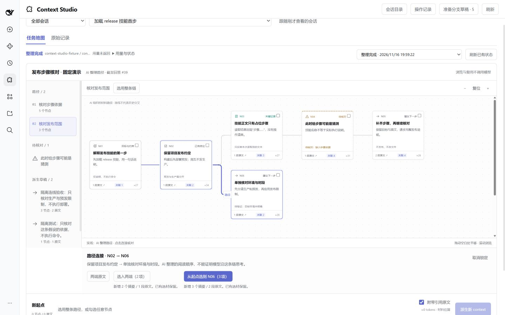

从 v1.1 升级到 **v1.8.0**：围绕“AI 为什么答偏、哪些材料值得带走”，重做上下文检查和整理后的使用流程。v1.2–v1.7 是本地开发阶段，本次一并公开。



## 现在可以怎样用

1. **排查当前回答**：在“原始记录”选择一次输出，查看新增、沿用和被替换的输入，沿工具请求、返回和会话引用核对当时的原文。长历史和正文分页显示。
2. **整理成可操作的图**：先选模型、预览范围和预算，明确确认后才消耗 tokens。完成后免费查看目标、结论、证据、待核对问题和下一步卡片。
3. **看清链和分叉**：有明确路径的报告显示 Git 风格分支。共用段合并，悬停追看、点击锁定，分叉处先选方向；两端原文和关系自身依据分别核对。
4. **使用整链或局部**：选整条路径、到某个节点的前缀、连接两端或任意卡片。关联和派生来源按需展开，已有选择和临时排除保留。
5. **开始新会话**：核对完整草稿和缺项后，再确认预填到目标工作区。已有草稿默认追加，不自动发送。成功后在本浏览器保存可回看的来源快照。

AI 整理路径是阅读与核对建议，不是模型隐藏思考或真实历史分叉；派生快照也不是 DSH 原生 fork。没有路径的旧报告仍可免费核对和局部选材，不会偷偷重新调用模型。

## 修复与升级变化

- 修复持续“读取脉络”、会话切换与迟到响应问题，增加读取截止和可重试出口。
- 长历史超过快照容量时保留回答导航，并按页查看原文；不将部分数据冒充完整快照。
- 修复 OpenCode 辅助整理的会话路由兼容，保留安全错误分类；失败不自动重跑生成。
- 草稿预览、跨会话确认失效、存储失败和重复派发均有回归覆盖。
- 原素材墙、脉络入口已由任务地图和原始记录取代；旧文件、备份和操作记录保留，历史撤销仍检查冲突。

## 安装 / 升级

要求：DSH 0.2.x、Node.js ≥22。

下载本页 Assets 中的 `dsh-plugin-context-studio-1.8.0.tgz`，在下载目录运行：

安装包 SHA-256：`8b850ab32c425a559550ba2f93adb4c0c81aadaa132dfe56de250e067977fcd9`。

```powershell
dsh plugin --profile desktop add ./dsh-plugin-context-studio-1.8.0.tgz
```

Windows 桌面安装目录为默认位置且没有 `dsh` 命令时：

```powershell
& "D:\DeepSeek Harness\resources\runtime\cli\bin\dsh.cmd" plugin --profile desktop add ./dsh-plugin-context-studio-1.8.0.tgz
```

网页版把 `--profile desktop` 换成 `--profile web`。安装后**完全退出 DSH（包括托盘），再重新打开**。

也可按 [README](https://github.com/h958661134/dsh-plugin-context-studio/blob/v1.8.0/README.md) 克隆并安装源码。已经链接本地源码目录的用户，更新该目录后重启即可；本次开发目录已是最新版本。旧整理结果无需付费重做，新路径需报告本身提供。

## 验证与范围

**427项 node:test 全通过**，打包检查通过。隔离 DSH 4001 实测了分叉核对、局部选材、预览取消、确认后只预填以及来源回看，另验证1440×900与900×800布局。截图中的报告为明确标记的固定演示，本轮未调用真实模型。

原生桌面、高DPI与完整无障碍矩阵仍需继续验收；真实模型输出质量和计费不由固定演示证明。来源快照只存当前浏览器，清除浏览器数据会丢失。详见 [工程校验](https://github.com/h958661134/dsh-plugin-context-studio/blob/v1.8.0/docs/REVIEW-1.8.md)。

[完整变更](https://github.com/h958661134/dsh-plugin-context-studio/compare/v1.1.0...v1.8.0) · [反馈问题](https://github.com/h958661134/dsh-plugin-context-studio/issues)
